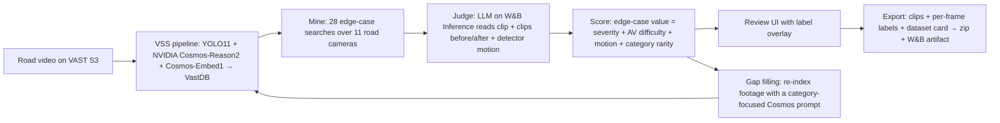

# Edge Case Miner

> Self-driving cars don't crash on the boring 99%. They crash on the weird 1%.
> Finding that 1% in petabytes of footage is the bottleneck. We find it.

Edge Case Miner is a video agent for the **VAST Builders Challenge (Video Agents)**. It digs through the team's
indexed road footage, pulls out rare driving scenarios (occluded jaywalkers, cyclists running reds, double-parked
trucks, emergency vehicles, near misses...), labels them, and **packages them as a versioned training dataset**
for autonomous-driving teams. Video becomes fuel for AI, not just something to watch.

## How it works



| Sponsor | Role |
|---|---|
| **VAST Data** | S3 video storage, DataEngine ingest pipeline, VastDB vector search (VSS blueprint) |
| **NVIDIA** | Cosmos-Reason2 scene descriptions, Cosmos-Embed1 search embeddings, YOLO11 detections |
| **CoreWeave** | GPUs serving the models |
| **Weights & Biases** | Inference for the judge model; dataset versioning as W&B artifacts |
| **Cursor** | Built with Cursor over Remote-SSH |

## Run it (on the lab VM)

```bash
cd edgecase
python3 miner.py          # mine + judge + score -> data/edge_cases.json   (~3-5 min)
python3 server.py         # web app on http://localhost:8080
python3 export.py --min-value 6   # optional CLI export (the app has an Export button)
```

No pip packages are needed for mining and the app (Python stdlib only). W&B artifact logging uses the repo venv:
`uv venv .venv && uv pip install --python .venv/bin/python wandb`. Credentials come from the VM's team config
(`/config/*.config`) and environment; nothing is stored in the repo.

From a laptop: `ssh -N -L 8080:localhost:8080 bc-<username>` then open http://localhost:8080.

## Inputs and outputs

- **Input:** the team's VSS index (segments with Cosmos descriptions, embeddings, YOLO detections).
- **`data/edge_cases.json`:** every candidate with category, title, explanation, tags, actors, conditions and scores.
- **Exported dataset** (`datasets/<name>/`): `clips/<id>.mp4`, `labels/<id>.json` (category, tags, scores, scene
  description, per-frame normalised boxes with an in-ego-path flag), `manifest.jsonl`, `DATASET_CARD.md`, plus a zip.

## Scoring

| Signal | Source | Weight |
|---|---|---|
| Edge-case score (1-10) | LLM judge, strict rubric, sees the clips before and after | 55% |
| AV difficulty (1-10) | LLM judge | 20% |
| Motion (0-10) | YOLO boxes: how large / fast-growing road users get in the vehicle's path (percentile) | 15% |
| Category rarity (0-10) | fewer confirmed examples in a category = more valuable | 10% |

A clip counts as an edge case when the judge says so, the category is not `routine`, and its edge-case score is at least 5.

## Evaluation

1. Open the app, tick **Show rejected candidates**, and spot-check accepted vs rejected clips against the video.
2. Every label file keeps the raw scene description and the searches that found it, so each decision is traceable.
3. The funnel (clips indexed → candidates → edge cases) shows how much routine footage was filtered out.

## Files

`edgecase/taxonomy.py` categories and searches · `miner.py` mining/judging/scoring · `motion.py` detector motion
signal · `export.py` / `wandb_log.py` dataset packaging · `reindex.py` gap-filling re-index · `server.py` + `static/` app.
