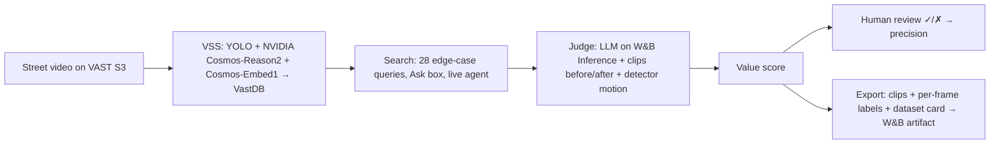

# Haystack 🪡

**Find the needle in your driving footage.**

> Self-driving cars don't crash on the boring 99%. They crash on the weird 1%.
> Finding that 1% in petabytes of footage is the bottleneck. Haystack finds it.

Haystack is a real-time video agent built for the **VAST Builders Challenge (Video Agents)**. It searches indexed street
and dashcam footage for rare driving moments, such as a pedestrian hidden behind a bus, a cyclist running a red, a double-parked
truck, an emergency vehicle or a near miss. An AI judge explains why each moment is hard for a self-driving car, and the
agent acts on what it finds: it adds confirmed edge cases to a labelled dataset and exports it as a versioned training set.

**Demo video:** _add link here_ · **Team 39:** Aadeeb Khan (@lifeageometer), @Baladog05, _add teammates_


## Try it in 60 seconds

1. On the lab VM: `cd edgecase && ../.venv/bin/python server.py`. Plain `python3 server.py` also works, but without Weave tracing.
2. From your laptop: `ssh -N -L 8080:localhost:8080 bc-<username>`, then open http://localhost:8080.
3. Type a scenario into **Ask the footage** (e.g. "cyclist running a red light"), click **Start live agent**, then export from **Dataset**.

## What it does

| Screen | What happens |
|---|---|
| **Ask the footage** | Free-text search over every indexed clip (Cosmos-Embed1 vectors in VastDB). Each hit is judged live by the LLM and streamed in as it's scored. One click adds it to the dataset. |
| **Live agent** | Keeps cycling through 28 edge-case searches. It judges every clip it hasn't seen, auto-adds anything with edge-case score ≥ 7, and raises an alert. |
| **Needles** | The mined dataset. Filter by category, sort, play each clip with the detector boxes drawn on top, and mark the judge ✓ correct or ✗ wrong (keys `Y`/`N`). |
| **Dataset** | Coverage per category, highlighting thin categories, and export to a zip plus a W&B artifact. |



## Sponsor tools used

| Sponsor | What we actually use |
|---|---|
| **VAST Data** | S3 video storage, the DataEngine ingest pipeline, and VastDB vector search via the VSS API (`/api/v1/search`, `/videos/detections`, `/videos/stream`, re-ingest) |
| **NVIDIA** | Cosmos-Reason2 scene descriptions (the judge's main evidence), Cosmos-Embed1 search embeddings, YOLO detections for the motion score and the overlay |
| **Weights & Biases** | W&B Inference serves the judge (`DeepSeek-V4.1-Flash`), Weave traces every judge call, and exports are logged as `edge-case-dataset` artifacts |
| **CoreWeave** | The GPUs serving the lab models, and the W&B instance we log to (forge.coreweave.com) |
| **Cursor** | All development in Cursor over Remote-SSH to the lab VM |

## Scoring

**Value (0–10)** = 55% edge-case score (judge) + 20% AV difficulty (judge) + 15% motion (YOLO: how big and fast road users
grow in the vehicle's path, as a percentile) + 10% category rarity (fewer confirmed examples = more valuable).
A clip is a **needle** when the judge says it's an edge case, the category isn't `routine`, and its edge-case score is at least 5.
Box colours: red = pedestrian or cyclist in the vehicle's path, amber = vehicle in the path, green = other.

## Inputs and outputs

- **Input:** the team's VSS index (612 videos, 3,537 five-second clips) with Cosmos descriptions, embeddings and YOLO detections.
- **`data/edge_cases.json`:** every candidate with category, title, explanation, tags, actors, conditions and scores.
- **Export** (`datasets/<name>/`): `labels/<id>.json` (category, tags, scores, scene description, per-frame normalised boxes
  with an in-path flag), `manifest.jsonl`, `DATASET_CARD.md`, optional `clips/<id>.mp4`, and a zip logged to W&B.

## Evaluation

- **Judge precision:** reviewers mark clips ✓ or ✗ in the app, and `python3 evaluate.py` writes `data/eval.json` with precision on
  accepted clips, the false-reject rate on reviewed rejected clips, and per-category precision. The header shows the live number.
  _Result: X% precision on N human-checked clips (fill in after review)._
- **Traceability:** every judge call is a Weave trace ([team-39 Weave project](https://wandb.ai/vastdata/team-39/weave)), and every
  label keeps the raw scene description and the searches that found it.
- **Funnel:** 3,537 clips → 184 candidates → 38 needles from the batch run. The rest of the footage is filtered out as routine.

## Run the batch miner

```bash
cd edgecase
python3 miner.py                  # 28 searches x 11 road cameras, judge, score -> data/edge_cases.json (~4 min)
python3 export.py --min-value 6   # CLI export; add --no-video to skip clip downloads
python3 reindex.py <stream_id> 10 near_miss   # gap filling: re-index a stream with a category-focused Cosmos prompt (changes the shared index!)
```

Mining and the app use only the Python standard library. Weave and W&B artifacts need the repo venv:
`uv venv .venv && uv pip install --python .venv/bin/python wandb weave`. Credentials are read from the VM team config
(`/config/*.config`) and are never stored in the repo.

## Files

`edgecase/server.py` web app and API · `static/index.html` UI · `ask.py` live search and judging · `watch.py` live agent ·
`miner.py` batch mining · `motion.py` detector motion · `taxonomy.py` categories and searches · `evaluate.py` judge precision ·
`export.py` + `wandb_log.py` dataset export · `reindex.py` gap filling · `vss.py` API, LLM and Weave helpers.
