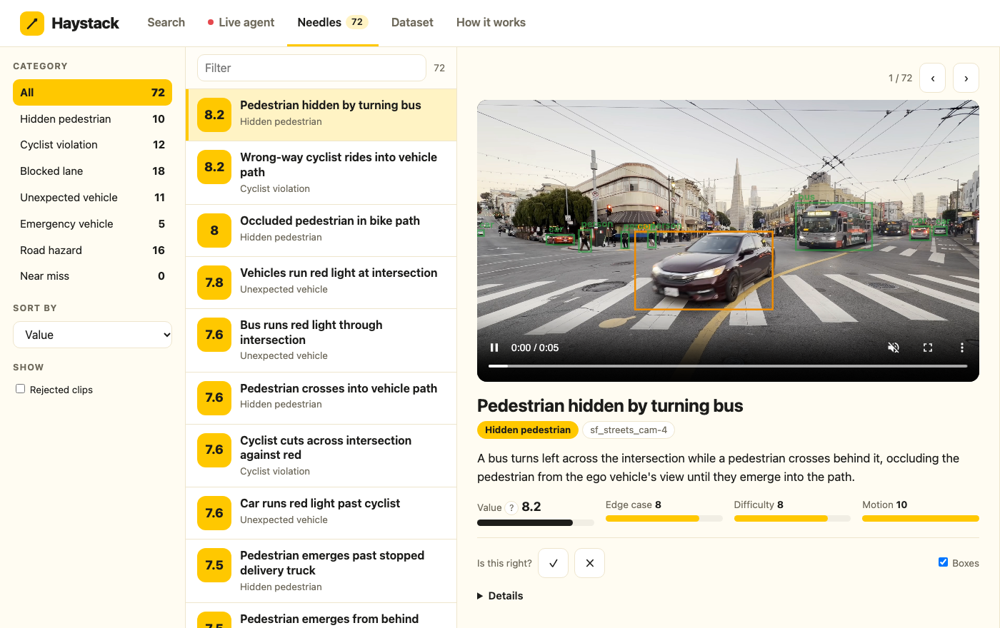
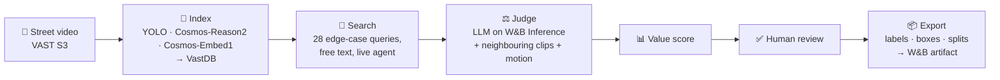
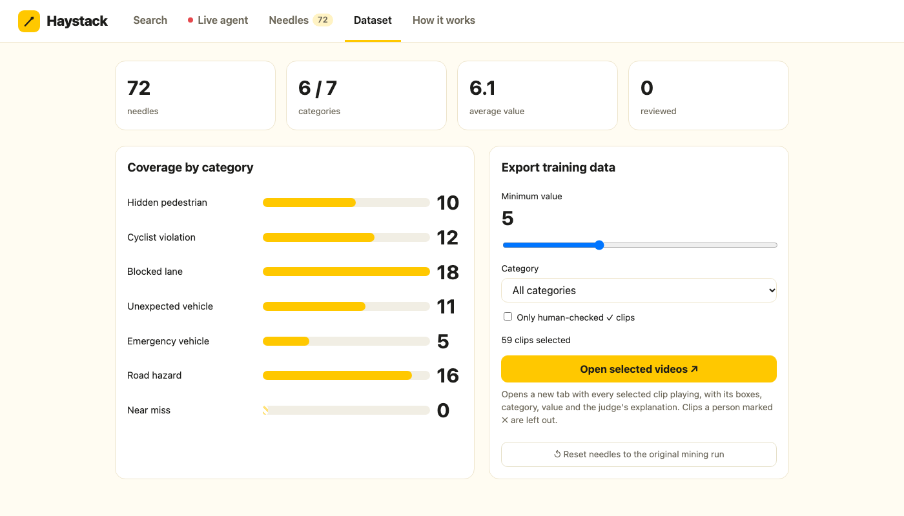

<div align="center">

# 🪡 Haystack

### Find the needle in your driving footage

**An autonomous video agent that mines rare, safety-critical driving moments from raw street footage<br>and packages them as labelled, versioned training data for self-driving teams.**

`VAST Builders Challenge: Video Agents` · `Team 39` · `London 2026`



</div>

---

## The problem

Self-driving systems don't fail on the routine 99% of driving. They fail on the rare 1%: a pedestrian stepping out from behind a bus, a cyclist riding the wrong way, a lorry double-parked across a lane. Fleets record petabytes of footage, but finding those few seconds by hand is slow and expensive, and that is now the bottleneck for training safer models.

## What Haystack does

Haystack watches the footage for you. It searches every indexed clip for risky scenarios, has an AI judge explain why each moment is hard for an autonomous vehicle, scores how valuable that clip is as training data, and adds the confirmed ones to a dataset you can review and export.

| | |
|---|---|
| **Input** | 612 street and dashcam videos from 11 road cameras, split into 3,537 five-second clips and indexed by the VAST Video Search Service |
| **Output** | A curated dataset of edge cases, each with category, plain-English explanation, scores, scene description and per-frame bounding boxes |
| **First mining run** | 3,537 clips → 184 candidates → 38 needles. The live agent and search keep adding more (72 at the time of writing) |

## How it works



1. **Index.** VAST's pipeline runs YOLO detection, NVIDIA Cosmos-Reason2 scene descriptions and Cosmos-Embed1 embeddings over every clip, and stores them in VastDB.
2. **Search.** 28 targeted queries across 7 edge-case categories retrieve candidate clips by vector similarity.
3. **Judge.** An LLM reads the scene description, the clips just before and after, and detector motion, then decides whether the moment is a genuine edge case and explains why.
4. **Score.** Each clip gets a 0–10 value score so the most useful training examples rise to the top.
5. **Review.** People mark the judge right or wrong, which gives a live precision figure and keeps bad labels out of the export.
6. **Export.** Selected clips become a versioned dataset with labels, boxes and a dataset card, logged to Weights & Biases.

## The app

| View | What it's for |
|---|---|
| **Search** | Describe a scenario in plain English ("cyclist running a red light"). Results stream in as each clip is judged, and one click adds a clip to the dataset. |
| **Live agent** | Works through unchecked clips across all cameras like a safety operator watching live feeds. Quiet scenes are triaged out cheaply, the rest go to the judge, and anything scoring 6+ is added automatically with an on-screen alert. |
| **Needles** | The mined dataset. Filter by category, play each clip with detector boxes overlaid, and mark the judge ✓ or ✗ (keys `Y` / `N`). |
| **Dataset** | Coverage per category, a gallery tab of every clip the current export settings select, and a one-click demo reset. |
| **How it works** | Live pipeline stats and a guide to the site. |

Box colours: **red** is a pedestrian or cyclist in the vehicle's path, **amber** is a vehicle in the path, **green** is any other road user.



## Edge-case taxonomy

| Category | Example |
|---|---|
| Occluded pedestrian / jaywalker | Pedestrian hidden by a turning bus |
| Cyclist / scooter rule violation | Wrong-way cyclist in the vehicle's path |
| Blocked lane / double-parked vehicle | Delivery truck stopped across a lane |
| Unexpected vehicle manoeuvre | Car running a red light at a junction |
| Emergency / special vehicle | Ambulance or fire engine approaching |
| Road anomaly / odd object | Debris, roadworks or an unusual obstacle |
| Near miss / close call | Two road users narrowly avoiding contact |

## Scoring

$$
\text{value} = 0.55 \cdot \text{edge score} + 0.20 \cdot \text{AV difficulty} + 0.15 \cdot \text{motion} + 0.10 \cdot \text{rarity}
$$

- **Edge score** and **AV difficulty** come from the judge.
- **Motion** is a percentile from YOLO tracks: how large and how fast road users grow in the vehicle's path.
- **Rarity** rewards categories with fewer confirmed examples, so the dataset stays balanced.

A clip counts as a **needle** when the judge calls it an edge case, its category isn't `routine`, and its edge score is at least 5.

## Dataset export

Each export (`edgecase/datasets/<name>/`) is a ready-to-train package:

- `labels/<id>.json` with category, tags, scores, scene description and per-frame normalised boxes flagged as in-path or not
- `annotations_coco.json` with the boxes in COCO format
- `splits/train.txt` and `splits/val.txt`, holding out whole cameras for validation (about 20%) so the model is tested on scenes it hasn't seen
- `manifest.jsonl`, `DATASET_CARD.md` and a `preview.jpg` contact sheet
- optional `clips/<id>.mp4`, all zipped and logged to W&B as a versioned `edge-case-dataset` artifact

Clips a reviewer marked ✗ are always left out, and `--only-confirmed` keeps only clips a person has checked.

## Built with

| Partner | How Haystack uses it |
|---|---|
| **VAST Data** | S3 video storage, the DataEngine ingest pipeline, and VastDB vector search through the VSS API |
| **NVIDIA** | Cosmos-Reason2 scene descriptions (the judge's main evidence), Cosmos-Embed1 search embeddings, and YOLO detections for motion and box overlays |
| **Weights & Biases** | W&B Inference serves the judge (DeepSeek-V4.1-Flash), Weave traces every judge call, and exports are logged as artifacts |
| **CoreWeave** | GPUs serving the lab models, and the W&B instance at forge.coreweave.com |
| **Cursor** | All development, over Remote-SSH to the lab VM |

## Quick start

```bash
# On the lab VM
cd edgecase
../.venv/bin/python server.py        # plain python3 also works, without Weave tracing

# On your laptop
ssh -N -L 8080:localhost:8080 bc-<username>
open http://localhost:8080
```

The app and miner use only the Python standard library. Weave tracing and W&B artifacts need the repo venv:

```bash
uv venv .venv && uv pip install --python .venv/bin/python wandb weave
```

Credentials are read from the VM's team config (`/config/*.config`) and are never stored in the repo.

## Command line

```bash
cd edgecase
python3 miner.py                          # batch mining: 28 searches × 11 cameras → data/edge_cases.json (~4 min)
python3 export.py --min-value 6           # build a dataset; add --no-video, --only-confirmed, --categories
python3 evaluate.py                       # judge precision from human reviews → data/eval.json
python3 reindex.py <stream_id> 10 near_miss   # re-index a stream with a category-focused prompt (changes the shared index)
```

## Evaluation and traceability

- **Judge precision.** Every ✓ / ✗ review feeds `evaluate.py`, which reports precision on accepted clips, the false-reject rate on rejected ones, and a per-category breakdown. The live figure appears in the app header.
- **Full trace.** Every judge call is recorded in Weave ([team-39 project](https://wandb.ai/vastdata/team-39/weave)), and every label keeps the raw scene description and the searches that found it.

## Repository layout

```
edgecase/
├── server.py        web app and API
├── static/          index.html (app) and gallery.html (selected-clips tab)
├── live.py          live agent: triage, judge, auto-add
├── ask.py           free-text search with live judging
├── miner.py         batch mining and value scoring
├── motion.py        detector-based motion score
├── taxonomy.py      categories, queries and cameras
├── evaluate.py      judge precision from human reviews
├── export.py        dataset export (labels, COCO, splits, preview)
├── wandb_log.py     W&B artifact logging
├── reindex.py       category-focused re-indexing
└── vss.py           VSS API, LLM and Weave helpers
```

## Team

Team 39 at the VAST Builders Challenge, London: Aadeeb Khan ([@lifeageometer](https://github.com/lifeageometer)) and [@Baladog05](https://github.com/Baladog05).
